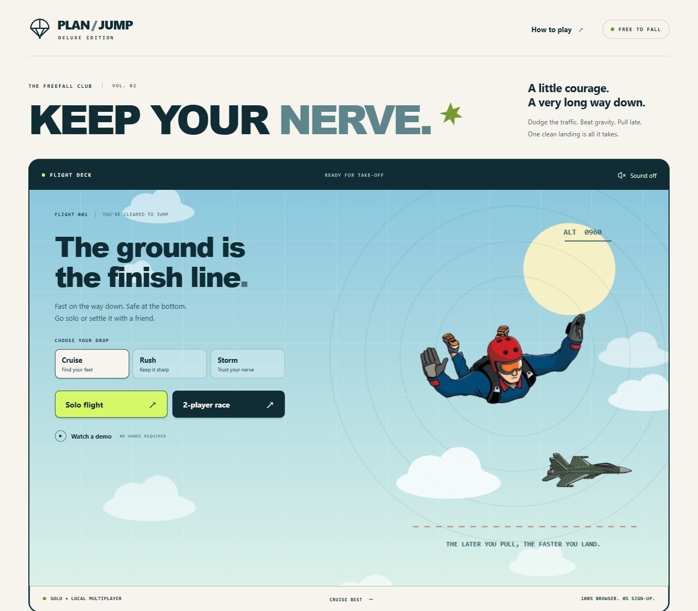

<div align="center">

# Plan-Jump Deluxe

### Keep your nerve. The ground is the finish line.


[](https://github.com/deleted04user/plan-jump-deluxe/actions/workflows/quality.yml)

A free browser arcade game: jump from a helicopter, dodge the sky traffic, and deploy your parachute as late as you safely can.

**[Play the live demo](https://deleted04user.github.io/plan-jump-deluxe/)** · **[Original project](https://github.com/OUSSAAMAA/plan-jump)**



</div>

## The game

Solo is a race against your personal best. Local two-player mode is a best-of-three race on one keyboard: leave the helicopter within three seconds, avoid every obstacle, and land safely before your opponent. Open the chute above **150 metres**. The later you open it, the less time you spend drifting.

The **Watch a demo** button flies the actual course with autopilot. It shows the dodges and a safe late deployment without changing your records. No account, downloads, or API key is required to play.

## Features

- Solo time trials with the five fastest safe landings per difficulty and input method
- Local two-player races, equivalent courses, a match scoreboard, and simultaneous-outcome draws
- Cruise, Rush, and Storm difficulty levels with planes, balloons, drones, and stronger wind
- Reproducible solo courses so records compare the same route
- A complete autoplay demonstration at every difficulty
- Keyboard controls and on-screen touch controls, including two-player touch controls
- Pause, automatic pause when the page loses focus, resume, and instant retries
- Music and generated sound effects with a saved sound preference; silent by default
- Optional hand steering processed locally in a worker, with explicit camera opt-in
- Responsive menus, semantic buttons, visible focus, status announcements, and reduced-motion support
- Safe fallback when camera access or local storage is unavailable
- No npm runtime dependencies and no network requirement for regular gameplay after the page loads

## Controls

| Action | Solo | Player 1 | Player 2 |
| --- | --- | --- | --- |
| Jump / deploy | Space | W | ↑ |
| Steer left | ← | A | ← |
| Steer right | → | D | → |
| Pause / resume | P or Escape | P or Escape | P or Escape |
| Restart current flight | R | R | R |
| Toggle sound | M | M | M |

Touch users can use the buttons immediately below the playfield. In camera mode, move your hand sideways to steer; **Space or the Deploy button still opens the chute**. Camera steering and keyboard steering share the same speed limit.

## Run locally

Install **Node.js 22 or later**, then:

```sh
git clone https://github.com/deleted04user/plan-jump-deluxe.git
cd plan-jump-deluxe
npm ci
npm run dev
```

Open `http://127.0.0.1:5173`. There are no packages to download; `npm ci` checks the lockfile. You can also run the development server directly with `node scripts/serve.mjs`.

```sh
npm run check     # JavaScript syntax
npm test          # Gameplay, records, match outcomes, and camera cancellation
npm run build     # Creates the static dist/ folder
npm run preview   # Serves dist/ at http://127.0.0.1:4173
```

## Demo hosting

The live game uses GitHub Pages, like [LUMA](https://github.com/deleted04user/LUMA). The deployment workflow verifies the game, builds the static files, and deploys changes from `main`. All asset, audio, and worker paths are relative, so the game also works under a repository subdirectory.

To deploy your own copy, enable **Settings → Pages → Source: GitHub Actions**, then run the **Deploy live demo** workflow. The included `vercel.json` also supports a Vercel deployment.

## Project structure

```text
index.html               Accessible menus, controls, and flight reports
src/core.js              Deterministic physics, courses, outcomes, and records
src/app.js               Input, interface state, sound, and session lifecycle
src/renderer.js          Canvas sky, hazards, original artwork, and cameras
src/handTracker.js       Camera permission and cancellation-safe lifecycle
src/camera-worker.js     Optional MediaPipe hand detection off the game thread
src/audio.js             Music and generated effects
src/storage.js           Validated browser-local preferences and records
src/style.css            Responsive visual design
tests/                   Regression tests
scripts/                 Dependency-free build, checks, and local server
assets/                  Original game artwork
.github/workflows/       Quality checks and public demo deployment
```

## Camera and records

The camera starts only when you choose **Try hand steering**. Video frames stay on your device; the optional model and runtime download from Google and jsDelivr. An HTTPS page or localhost, a camera, and a browser supporting workers and ImageBitmap are required. Leaving, restarting, pausing, or hiding the page stops the stream and worker. A delayed permission response is cancelled safely.

Records are local to this browser. Difficulty and keyboard, touch, or camera input each have their own board. Invalid stored data is ignored, and blocked storage does not stop a flight. Demo runs never earn records.

## Credits and license

Based on [OUSSAAMAA/plan-jump](https://github.com/OUSSAAMAA/plan-jump). The original skydiver, plane, explosion artwork, and music are preserved in the repository. Deluxe introduces a new interface and a dependency-free game simulation and renderer.

Released under the [ISC License](LICENSE), matching the original package's declared license.
